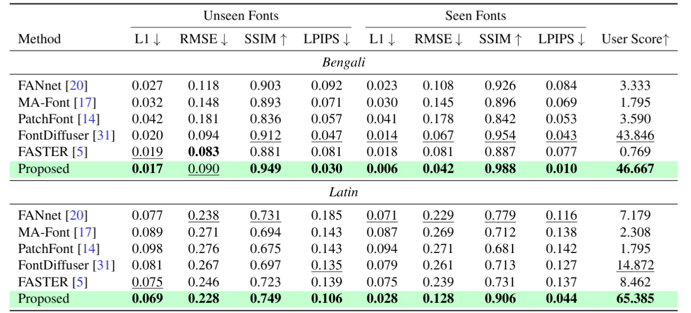

# CoDeFont

**Official implementation of CoDeFont**

[Project Website](https://rejoycs.github.io/codefont/) · [GitHub Repository](https://github.com/rejoycs/codefont)

---

## Overview

CoDeFont is a research project in computer vision and generative modeling. This repository contains the implementation, training and inference entry points, model components, data-loading utilities, and loss functions.

## Visual Results

### Qualitative Comparison

<!-- Add the corresponding comparison figure to docs/qualitative_results.png -->

<p align="center">
  
</p>
<p align="center">
  
</p>

*Qualitative comparison of generated results. Replace this placeholder with the actual experimental figure.*

### Additional Results

<!-- Add an actual result figure to docs/additional_results.png -->

<p align="center">
  
</p>

*Additional examples and comparisons.*

> **Note:** The image paths above are proposed locations for figures. Add the corresponding image files to `docs/` before using these sections.

---

## Repository Structure

```text
CoDeFont/
├── dataloader/    # Data loading and preprocessing
├── docs/          # Documentation and figures
├── losses/        # Loss functions
├── models/        # Model and network components
├── scripts/       # Training and inference Python modules
├── train.sh       # Training entry point
├── infer.sh       # Inference entry point
├── LICENSE        # License information
└── README.md      # Project documentation
```

## Which File Should I Run?

| File | Purpose |
|---|---|
| `train.sh` | Start model training |
| `infer.sh` | Run inference using trained checkpoints |
| `scripts/train.py` | Training implementation invoked through `python -m scripts.train` |
| `scripts/infer.py` | Inference implementation invoked through `python -m scripts.infer` |
| `dataloader/` | Data-loading components used by the pipeline |
| `models/` | Model architecture and network components |
| `losses/` | Training objectives and loss implementations |
| `docs/` | Documentation and visual assets |

The Python module paths shown above follow the launch commands in the shell scripts.

## Installation

Clone the repository:

```bash
git clone https://github.com/rejoycs/codefont.git
cd codefont
```

Create and activate a Python environment, then install the dependencies required by the implementation.

```bash
conda create -n codefont python=3.10
conda activate codefont
```

Install a compatible PyTorch build for your CUDA environment, followed by the project's Python dependencies.

## Dataset Preparation

The training and inference scripts expect language-specific directories.

For example, the launchers construct paths using:

```text
Dataset_bengali/
results_bengali/
results_bengali_out/
ckpt/
```

Prepare the dataset in the format expected by the data-loading implementation before running the scripts. Check the dataset configuration and preprocessing code for the required directory structure and image format.

## Training

The repository provides `train.sh` as the main training entry point.

```bash
bash train.sh
```

To specify another language:

```bash
bash train.sh english
```

The script invokes `scripts.train` with the following configured parameters:

- Batch size: `64`
- Embedding dimension: `64`
- Image size: `64 × 64`
- Epochs: `500`
- Device: `cuda:0`
- Test interval: `1`

Training checkpoints are configured under `ckpt/`, with separate paths for the style encoder, content encoder, decoder, and discriminator.

## Inference

Use `infer.sh` to generate results using trained model checkpoints.

```bash
bash infer.sh
```

To run inference for another language:

```bash
bash infer.sh english
```

The script invokes `scripts.infer` and reads the configured style encoder, content encoder, and decoder checkpoints.

By default, the output directory is:

```text
results_bengali_out/
```

For another language, the output directory follows the pattern `results_<language>_out/`.

**Important:** Run inference only after the required model checkpoints are available at the paths expected by `infer.sh`. Verify that the dataset and checkpoint paths match your local setup.

## Configuration

The current shell scripts define the primary execution parameters. To change the default language, batch size, embedding dimension, image size, checkpoint locations, or device, edit `train.sh` or `infer.sh` as appropriate.

For a different GPU, update the `--DEVICE` argument. For CPU execution, first confirm that the underlying implementation supports CPU inference and training.

## Citation

If you use CoDeFont in your research, please cite the associated paper.
```bibtex
@misc{chakraborty2026codefontoneshotfontgeneration,
      title={CoDeFont: One-Shot Font Generation via Multi-Scale Factor-Specific Representation Learning}, 
      author={Rejoy Chakraborty and Prasun Roy and Saumik Bhattacharya and Umapada Pal},
      year={2026},
      eprint={2610.21364},
      archivePrefix={arXiv},
      primaryClass={cs.CV},
      url={https://arxiv.org/abs/2610.21364}, 
}
```

Please refer to the [official project website](https://rejoycs.github.io/codefont/) for project information.

## License
This project is distributed under the Apache License 2.0. See [LICENSE](LICENSE) for details.
